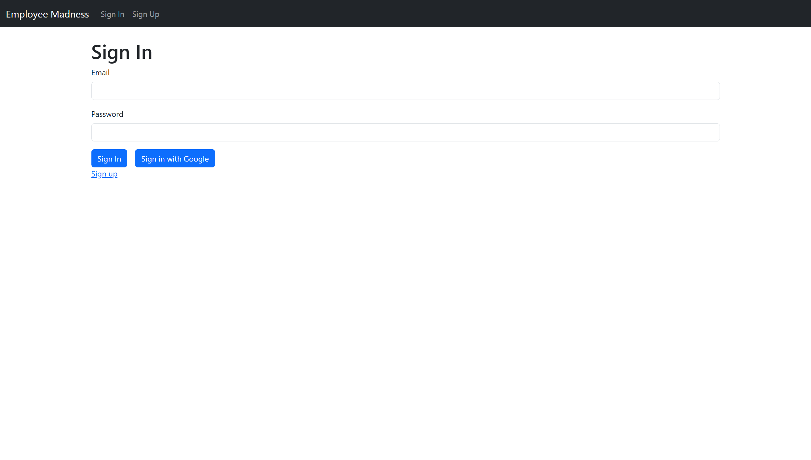
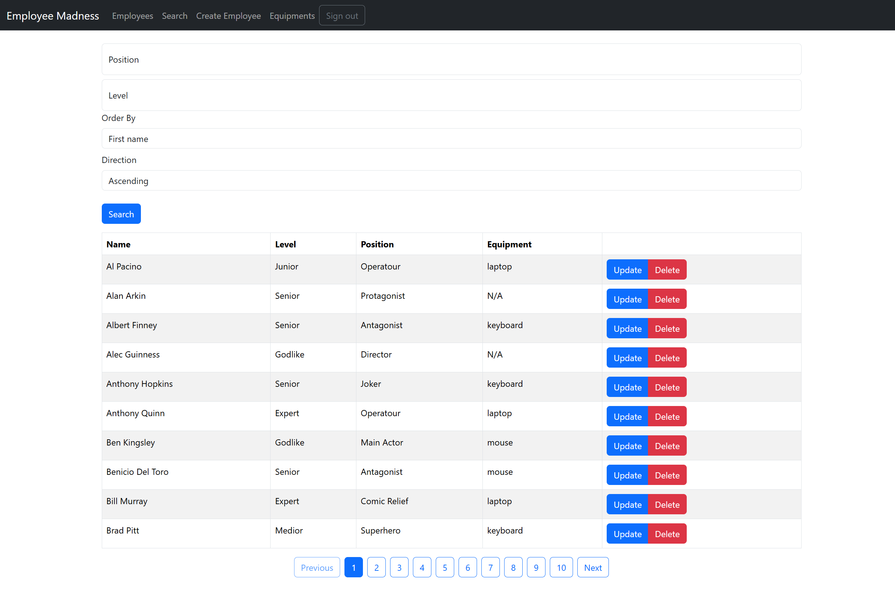
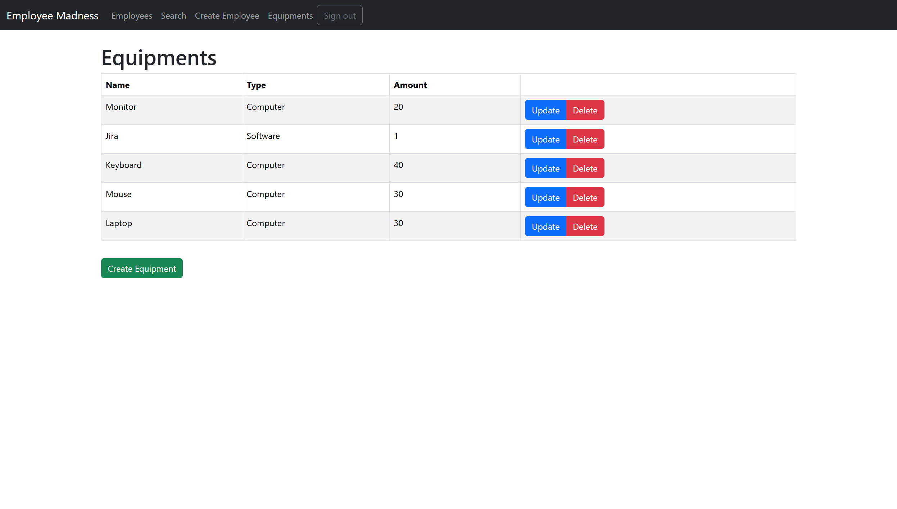

# Employee Madness

A React-based employee and company equipment management application built as a Codecool project. It uses Firebase Authentication for sign-in and the Firebase Realtime Database REST API for data storage.

**Live demo:** [employee-madness-demo.web.app](https://employee-madness-demo.web.app/)

**Tests:** Vitest + React Testing Library ([testing details](TESTING.md))

## Features

- **Authentication:** sign up and sign in with email/password or Google; sign out and protected application routes.
- **Employee management:** create, view, update and delete employee records, including names, position, level and assigned equipment.
- **Filtering and sorting:** filter employees by position and level; sort by first, middle or last name, position or level, in ascending or descending alphabetical order.
- **Search:** find employees by an exact first or full name using the `/employees/:search` route (case-insensitive).
- **Pagination:** browse employee records 10 at a time.
- **Equipment management:** create, view, update and delete equipment records with a name, type and quantity; select equipment when editing an employee.
- **Feedback:** loading indicators, validation messages and error/empty-state messages.

## Screenshots

### Sign In


### Employees


### Equipments


## Tech stack

| Area | Technology |
| --- | --- |
| Frontend | React 18, JavaScript, React Router 6, Vite 5 |
| UI | Bootstrap 5, Sass |
| Authentication | Firebase Authentication (Google and email/password) |
| Data | Firebase Realtime Database via its REST API |
| Testing | Vitest, React Testing Library, Testing Library User Event, V8 coverage |
| Hosting | Firebase Hosting (existing demo) |

## Getting started

### Requirements

- Node.js 20+ and npm
- A Firebase project with **Realtime Database** enabled

### 1. Configure Firebase

1. Create or select a project in the [Firebase Console](https://console.firebase.google.com/).
2. Add a **Web app** to that project and locate its Firebase configuration values.
3. Enable **Authentication → Sign-in method → Email/Password** and **Google**.
4. Create a **Realtime Database** and note its database URL (not the Firestore URL).
5. In **Realtime Database → Rules**, publish the rules from [`database.rules.json`](database.rules.json). They allow authenticated access and index `employees/list/fullName`, which is required for the REST search query.

> **Demo security:** the provided rules allow **any signed-in user** to read and modify all records. Use a dedicated Firebase project with **test data only**. These rules are intended for the original learning exercise, not for real employee or company data.

> **Firebase CLI note:** `.firebaserc` references the original project. If you plan to deploy with the Firebase CLI, select your own project first; do not deploy to the original project unintentionally.

### 2. Set environment variables

Copy the included sample file:

```bash
cp .env.sample .env.local
```

Fill in the variables from your Firebase web app configuration:

```dotenv
VITE_FB_apiKey=
VITE_FB_authDomain=
VITE_FB_projectId=
VITE_FB_storageBucket=
VITE_FB_messagingSenderId=
VITE_FB_appId=
VITE_FB_DATABASE_URL=
```

`VITE_FB_DATABASE_URL` must be the **Realtime Database URL**. Leave off the trailing `/`. The `.env.local` file is Git-ignored. Never commit Firebase Admin service account keys or other private credentials; Vite's `VITE_` variables are included in the client bundle, so they must not contain secrets.

### 3. Install and run

```bash
npm ci
npm run dev
```

Open the local address shown by Vite (normally [http://localhost:5173](http://localhost:5173)). Sign up or sign in to access the employee and equipment pages.

If Firebase Authentication rejects local sign-in, check that `localhost` is listed under **Authentication → Settings → Authorized domains** for your Firebase project.

## Commands

| Command | Description |
| --- | --- |
| `npm run dev` | Start the development server |
| `npm run build` | Create a production build in `dist/` |
| `npm run preview` | Preview the production build locally |
| `npm test` | Run all automated tests once |
| `npm run test:watch` | Run tests in watch mode |
| `npm run test:coverage` | Generate a code coverage report |
| `npm run lint` | Run ESLint |


## Running with Docker

The application can also be run using Docker and Docker Compose.
A multi-stage Dockerfile builds the React application with Node.js
and serves the production files using Nginx.

### Prerequisites

- Docker Desktop with Docker Compose
- A configured Firebase project
- A `.env.local` file containing the required Firebase configuration

### Start the application

From the project root directory, run:

```bash
docker compose --env-file .env.local up --build -d
```

Once the containers are running, open:

http://localhost:8080

### Useful commands

View container logs:

```bash
docker compose --env-file .env.local logs web
```

Stop the application:

```bash
docker compose --env-file .env.local down
```

Rebuild and restart:

```bash
docker compose --env-file .env.local up --build -d
```

**Note:** Firebase configuration variables are embedded during the
Vite build process. Rebuild the Docker image if these values change.

For additional details, see [Docker documentation](DOCKER.md).


## Testing

The project includes **49 automated tests across 11 test files** (last verified locally), covering the REST API, CRUD flows, filtering, sorting, searching, pagination, forms, authentication context and protected routes. The most recently reported line coverage was **80.42%**.

```bash
npm test
npm run test:coverage
npm run build
```

Firebase requests are mocked in these tests: the test suite does **not** require Firebase credentials and does **not** modify the online database. See [TESTING.md](TESTING.md) for more details.

## How it works

```text
React UI
   ├── Firebase Authentication (email/password or Google)
   └── Employee / Equipment API clients
          └── HTTPS + Firebase ID token
                 └── Firebase Realtime Database REST API
                        ├── employees/list
                        └── equipments/list
```

The application stores a normalized lowercase `fullName` field for indexed search and keeps the employee/equipment UI logic in React components. Employees can reference equipment through the employee form.

## Optional: sample data seeding

The repository includes a Firebase Admin SDK seeder in [`seeder/`](seeder/). It needs a Firebase service account file named `seeder/account.json` and a configured `.env.local`.

**Warning:** `npm run seed` first **deletes every existing record under `employees/list`**, then inserts generated sample employees. Only run it against a disposable test database. Never commit `account.json`.

## Project background

This application was built for a Codecool learning assignment focused on React Context, Firebase Authentication, REST-based CRUD operations and database querying. It was later polished for a developer portfolio with additional error handling, UI feedback and automated tests.
